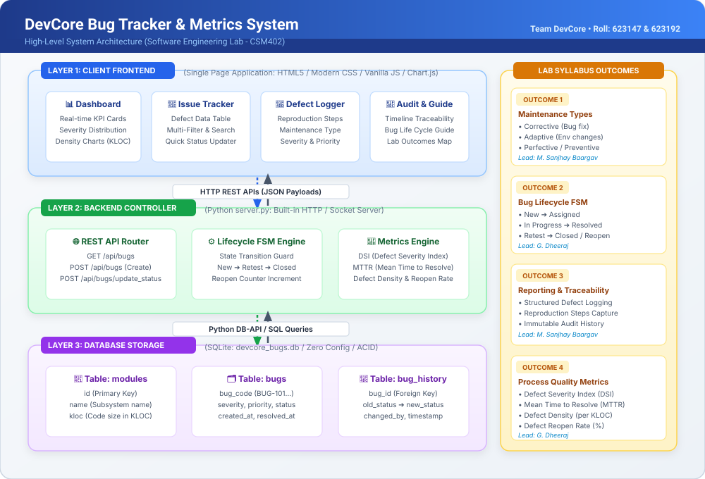
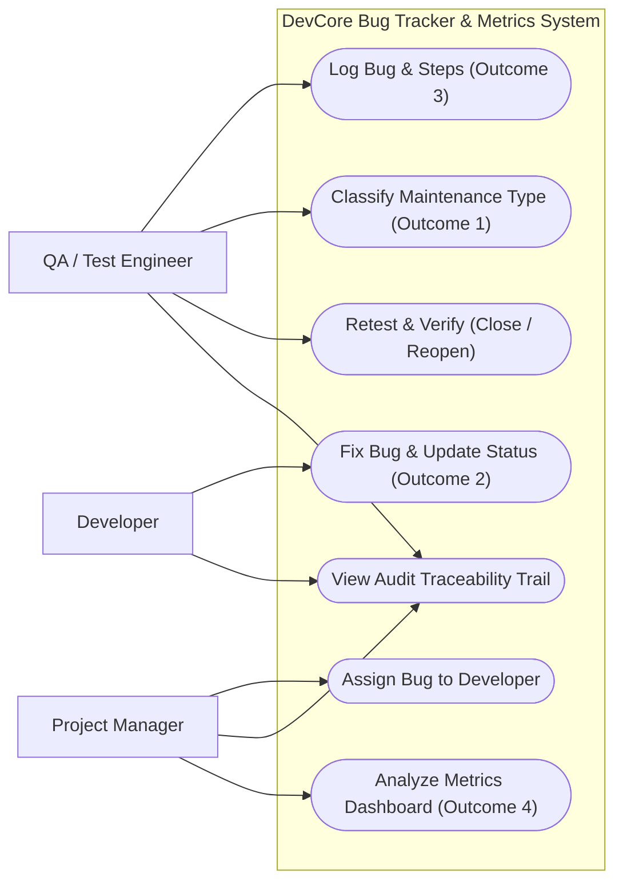
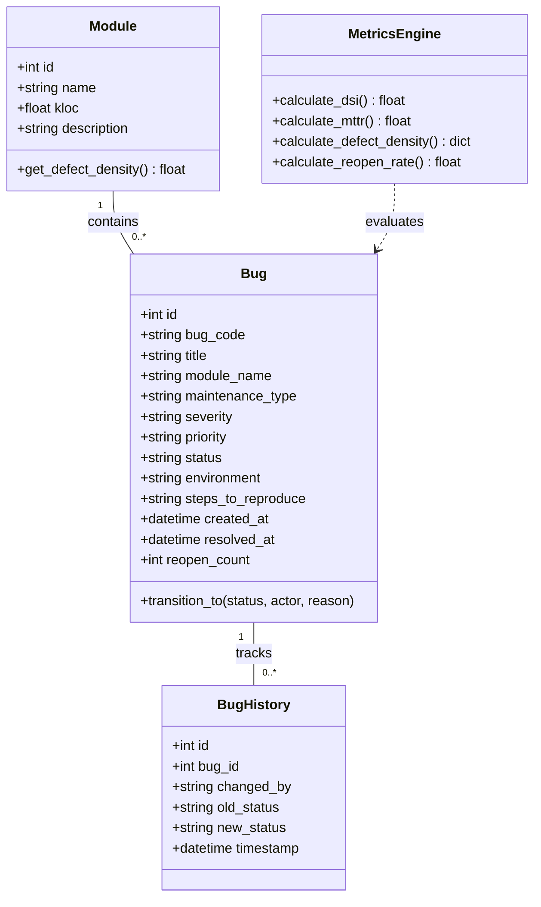
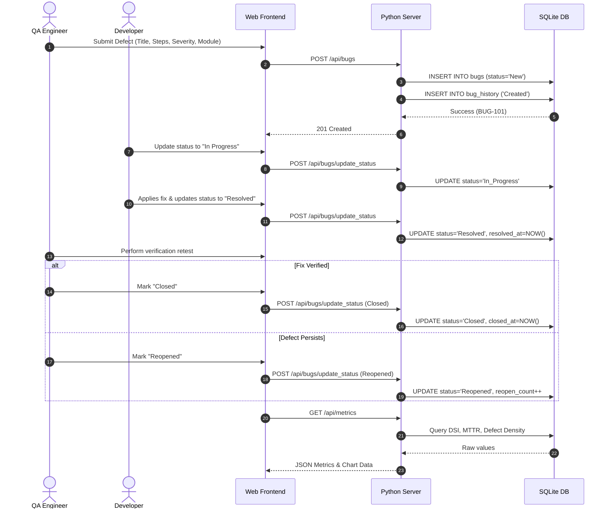
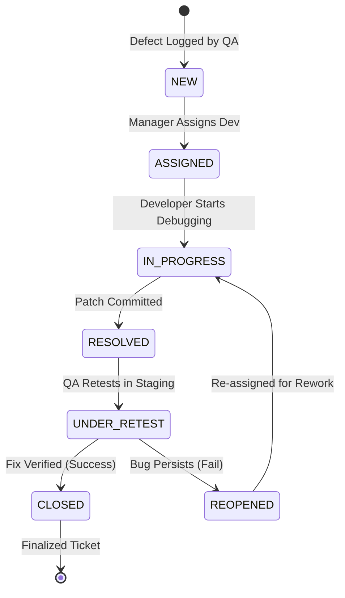
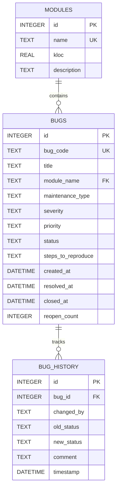

# DEVCORE BUG TRACKER & PROCESS METRICS SYSTEM
## Software Requirements Specification (SRS) & Product Requirements Document (PRD)
### Software Engineering Lab (CSM402) — Project Title #12
**Department:** Electronics & Communication Engineering (ECE) | B.Tech 4th Year  
**Team:** DevCore  

| Team Member Name | Roll Number | Lab Outcome Responsibilities |
| :--- | :--- | :--- |
| **M. Sanjhay Baargav** | **623147** | Systems Analyst & Backend Lead (Outcomes 1 & 3) |
| **G. Dheeraj** | **623192** | Quality Assurance Lead & Metrics Specialist (Outcomes 2 & 4) |

---

## 1. Project Overview & Problem Statement

In modern software engineering, software maintenance represents **60% to 70% of total lifecycle costs**. When defects escape testing into production, they lead to financial damage, system downtime, and poor user trust.

The **DevCore Bug Tracker** is an integrated software defect management and metrics evaluation platform developed for the CSM402 lab curriculum. It provides a full, zero-configuration working implementation addressing all 4 mandatory syllabus outcomes:

1. **Outcome 1 (Analyze Maintenance Requirements):** Classifies defects into the four standard IEEE maintenance categories: Corrective, Adaptive, Perfective, and Preventive.
2. **Outcome 2 (Design Bug Life Cycle Workflows):** Enforces a formal finite state machine (New ➔ Assigned ➔ In Progress ➔ Resolved ➔ Under Retest ➔ Closed / Reopened).
3. **Outcome 3 (Implement Issue Reporting & Tracking):** Captures reproduction steps, test environments, severity/priority matrices, and maintains an immutable audit trail.
4. **Outcome 4 (Evaluate Process Improvement Metrics):** Dynamically calculates Defect Severity Index (DSI), Mean Time to Resolution (MTTR), Defect Density per KLOC, and Defect Reopen Rate.

---

## 2. Stakeholder Personas & Roles

| Role | Primary Lab Responsibilities | Industry / Agile Equivalent |
| :--- | :--- | :--- |
| **QA / Test Engineer** | Identifies and logs defects with reproduction steps; verifies fixes during retest; closes or reopens tickets. | Tester in Agile Sprint execution. |
| **Developer** | Investigates root causes, writes code patches, performs unit tests, and moves tickets to Resolved. | Software Engineer / Developer. |
| **Project Manager** | Triages incoming defects, sets Priority (P1–P4), assigns tickets to developers, and tracks release quality. | Product Owner (PO) managing the defect backlog. |
| **Scrum Master** | Does not fix bugs directly. Inspects the *Metrics Dashboard* (MTTR, Reopen Rate) during Sprint Retrospectives to remove team bottlenecks. | Scrum Master facilitating the Agile process. |

---

## 3. High-Level System Architecture

DevCore runs on a clean, 3-tier modular architecture with zero external runtime dependencies (runs out of the box on standard Python 3 and SQLite):



* **Tier 1 (Presentation Layer):** Single-page web application (`static/index.html`) using HTML5, responsive CSS, and Chart.js for real-time visualization of KPIs, issue grids, and audit timelines.
* **Tier 2 (Application Layer):** Python backend server (`server.py`) serving RESTful JSON endpoints, enforcing state machine transition rules, and computing software metrics.
* **Tier 3 (Persistence Layer):** Relational SQLite database (`devcore_bugs.db`) storing `modules` (with KLOC code size), `bugs`, and `bug_history` audit records.

---

## 4. Functional Requirements (Mapped to Lab Outcomes)

### Outcome 1: Software Maintenance Requirements Analysis
* **FR-1.1:** Every defect must be categorized into one of four IEEE standard maintenance types:
  * **Corrective:** Reactive fixing of faults and crashes (e.g., 504 Gateway Timeout in billing).
  * **Adaptive:** Modifying software for environmental changes (e.g., Windows 11 high-DPI canvas fix).
  * **Perfective:** Proactive feature enhancements (e.g., CSV export addition).
  * **Preventive:** Refactoring code to prevent latent defects (e.g., closing unhandled database connections).
* **FR-1.2:** The system maintains pre-configured subsystem modules with their codebase size in KLOC (Thousands of Lines of Code) to normalize defect measurements.

### Outcome 2: Bug Life Cycle Workflow Management
* **FR-2.1:** State transitions strictly adhere to the formal state machine:
  $$\text{NEW} \longrightarrow \text{ASSIGNED} \longrightarrow \text{IN PROGRESS} \longrightarrow \text{RESOLVED} \longrightarrow \text{UNDER RETEST} \longrightarrow \text{CLOSED}$$
* **FR-2.2:** If a QA engineer determines that a fix failed verification, the status moves to **REOPENED**, increments the `reopen_count`, and returns to the developer queue.

### Outcome 3: Issue Reporting, Reproduction & Traceability
* **FR-3.1:** Captures structured defect metadata: Unique Code (e.g., `BUG-101`), Module, Severity (Critical, High, Medium, Low), Priority (P1–P4), Environment, Steps to Reproduce, Expected vs. Actual behavior.
* **FR-3.2:** Every state change automatically creates an immutable record in `bug_history` capturing `changed_by`, `old_status`, `new_status`, `timestamp`, and `comment`.

### Outcome 4: Process Improvement Metrics Engine
* **FR-4.1:** Real-time automated calculation of Defect Severity Index (DSI), Mean Time to Resolution (MTTR), Defect Density per KLOC, and Reopen Rate.

---

## 5. System Modeling & UML Diagrams

### 5.1 UML Use Case Diagram


---

### 5.2 UML Class Diagram


---

### 5.3 UML Sequence Diagram: Defect Lifecycle Flow


---

### 5.4 UML State Machine Diagram: Bug State Transitions


---

### 5.5 UML Activity Diagram: End-to-End Bug Resolution
```mermaid
flowchart TD
    Start([Start]) --> A[QA Finds Bug during Execution]
    A --> B[Record Steps to Reproduce & Environment]
    B --> C[Classify Maintenance: Corrective/Adaptive/Perfective/Preventive]
    C --> D[Submit Bug (status = NEW)]
    D --> E[Manager Assigns to Developer]
    E --> F[Developer Investigates & Authors Patch]
    F --> G[Developer Marks Status as RESOLVED]
    G --> H[QA Pulls Build for Retest]
    H --> I{Does the Defect Still Persist?}
    
    I -- Yes (Fail) --> J[Mark Status as REOPENED]
    J --> K[Increment Reopen Count & Add Comment]
    K --> F
    
    I -- No (Pass) --> L[Mark Status as CLOSED]
    L --> M[Capture Final Timestamp in Audit Trail]
    M --> N[Metrics Engine Automatically Re-computes DSI & MTTR]
    N --> EndNode([End / Defect Closed])
```

---

### 5.6 Entity-Relationship (ER) Diagram


---

## 6. Software Process Metrics & Numerical Calculations

### 1. Defect Severity Index (DSI)
Measures the overall severity risk of the system:
$$\text{DSI} = \frac{(4 \times N_{\text{Critical}}) + (3 \times N_{\text{High}}) + (2 \times N_{\text{Medium}}) + (1 \times N_{\text{Low}})}{\text{Total Defects}}$$
* **Sample Calculation:** If a build has 2 Critical, 1 High, 1 Medium, and 2 Low bugs (6 total):
  $$\text{DSI} = \frac{(2 \times 4) + (1 \times 3) + (1 \times 2) + (2 \times 1)}{6} = \frac{8 + 3 + 2 + 2}{6} = \frac{15}{6} = 2.50$$
* **Interpretation:** $\text{DSI} < 2.0$ indicates release stability; $\text{DSI} > 3.0$ indicates release instability.

### 2. Mean Time to Resolution (MTTR)
Measures team efficiency in debugging and patching defects:
$$\text{MTTR} = \frac{\sum (\text{Resolution Time of Resolved Bugs})}{\text{Total Resolved Bugs}}$$
* **Sample Calculation:** 3 bugs resolved in 10, 14, and 18 hours:
  $$\text{MTTR} = \frac{10 + 14 + 18}{3} = \frac{42}{3} = 14.0 \text{ hours}$$

### 3. Defect Density per KLOC
Normalizes defect counts against module codebase size:
$$\text{Defect Density} = \frac{\text{Total Defects in Module}}{\text{Codebase Size in KLOC}}$$
* **Sample Calculation:** Billing Gateway module has 3 defects across 6.8 KLOC:
  $$\text{Defect Density} = \frac{3}{6.8} = 0.44 \text{ defects / KLOC}$$

### 4. Defect Reopen Rate (%)
Measures fix quality and QA retest rigor:
$$\text{Reopen Rate} = \left(\frac{\text{Total Reopened Defects}}{\text{Total Closed or Resolved Defects}}\right) \times 100$$
* **Sample Calculation:** 1 reopened defect out of 5 resolved defects:
  $$\text{Reopen Rate} = \left(\frac{1}{5}\right) \times 100 = 20.0\%$$

---

## 7. Verification & Testing Matrix

| Test ID | Test Case | Action / Input | Expected Result | Result |
| :--- | :--- | :--- | :--- | :--- |
| **TC-01** | Defect Ingestion | Fill defect form, select "Billing Gateway" & "Corrective". | Record created with status = `NEW`, code generated, audit entry saved. | ✅ Pass |
| **TC-02** | Lifecycle State Guard | Transition ticket: `NEW` ➔ `IN PROGRESS` ➔ `RESOLVED`. | State transitions successfully; `resolved_at` timestamp captured. | ✅ Pass |
| **TC-03** | Reopen Loop | QA rejects fix during retest and selects `REOPENED`. | Status updates to `REOPENED`; `reopen_count` increments by 1. | ✅ Pass |
| **TC-04** | Dynamic Metrics | Change defect severities; inspect dashboard cards & charts. | DSI, MTTR, and Defect Density refresh in real time. | ✅ Pass |

---

*DevCore Bug Tracker & Metrics System • CSM402 Software Engineering Lab • Prepared by M. Sanjhay Baargav (623147) & G. Dheeraj (623192)*

