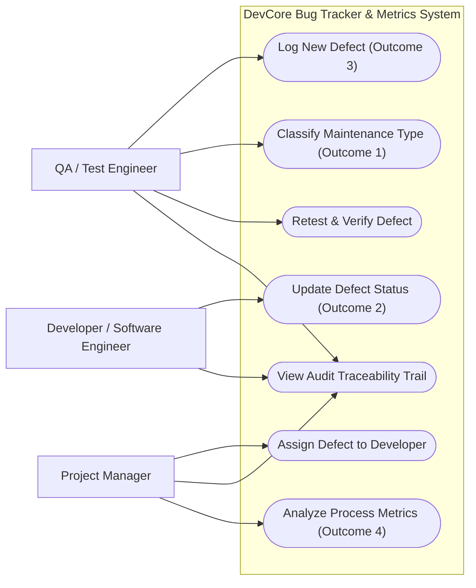
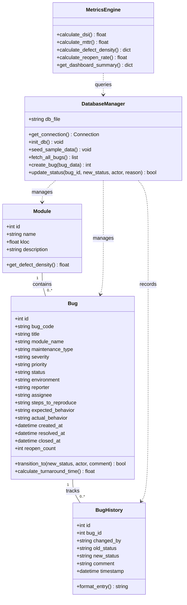
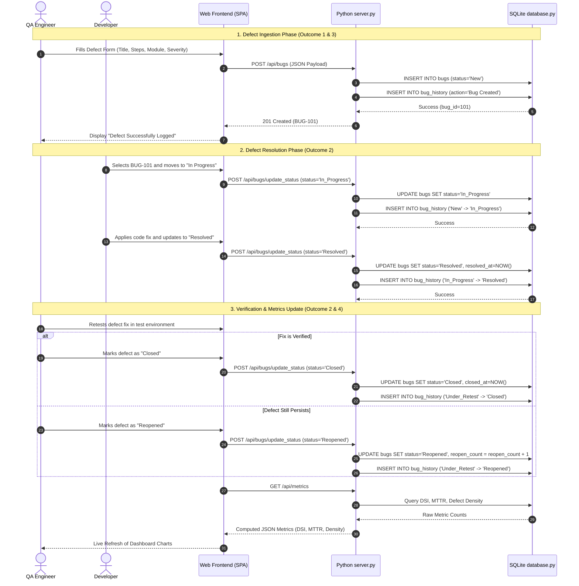
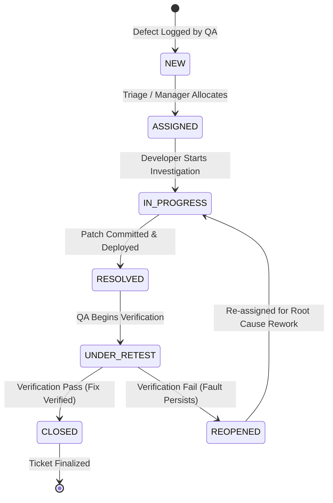
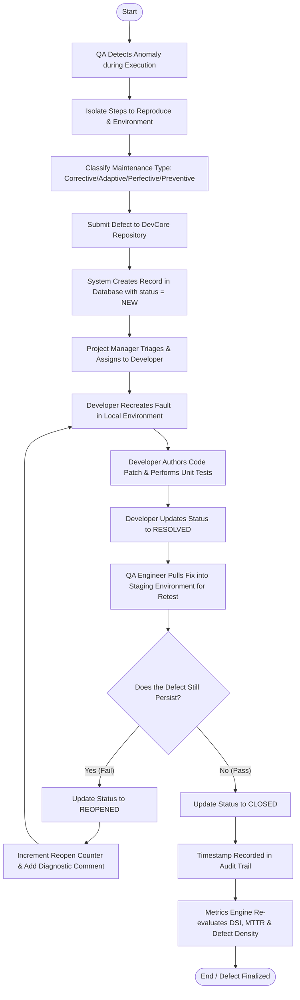
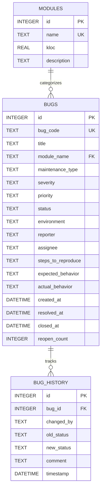

# SOFTWARE REQUIREMENTS SPECIFICATION (SRS)
## For DevCore Bug Tracker & Software Process Metrics System
### Prepared according to IEEE Std 830-1998 Standard

---

**Course:** Software Engineering Lab (CSM402) — Project Title #12  
**Department:** Department of Electronics and Communication Engineering (ECE)  
**Academic Year:** B.Tech 4th Year  
**Team Name:** DevCore  

| Team Member Name | Roll Number | Project Specialization |
| :--- | :--- | :--- |
| **M. Sanjhay Baargav** | **623147** | Systems Analyst & Backend Architecture |
| **G. Dheeraj** | **623192** | Quality Assurance Lead & Metrics Specialist |

---

## TABLE OF CONTENTS
1. [Introduction](#1-introduction)
   - 1.1 Purpose
   - 1.2 Document Conventions
   - 1.3 Intended Audience and Reading Suggestions
   - 1.4 Product Scope
   - 1.5 References and Applicable Standards
2. [Overall Description](#2-overall-description)
   - 2.1 Product Perspective
   - 2.2 Product Functions
   - 2.3 User Classes and Characteristics
   - 2.4 Operating Environment
   - 2.5 Design and Implementation Constraints
   - 2.6 User Documentation
   - 2.7 Assumptions and Dependencies
3. [External Interface Requirements](#3-external-interface-requirements)
   - 3.1 User Interfaces
   - 3.2 Hardware Interfaces
   - 3.3 Software Interfaces
   - 3.4 Communications Interfaces
4. [System Features & Functional Requirements](#4-system-features--functional-requirements)
   - 4.1 System Feature 1: Software Maintenance Requirements Analysis
   - 4.2 System Feature 2: Bug Life Cycle Workflow Management
   - 4.3 System Feature 3: Issue Reporting, Reproduction & Audit Logging
   - 4.4 System Feature 4: Process Improvement Metrics Engine
5. [Non-Functional Requirements (NFRs)](#5-non-functional-requirements-nfrs)
   - 5.1 Performance Requirements
   - 5.2 Safety & Reliability Requirements
   - 5.3 Security & Role-Based Access Control
   - 5.4 Software Quality Attributes
6. [System Modeling & UML Diagrams](#6-system-modeling--uml-diagrams)
   - 6.1 UML Use Case Diagram
   - 6.2 UML Class Diagram
   - 6.3 UML Sequence Diagram (Defect Logging to Closure)
   - 6.4 UML State Machine / Statechart Diagram
   - 6.5 UML Activity Diagram
   - 6.6 Entity-Relationship (ER) Diagram
7. [Requirements Traceability Matrix (RTM)](#7-requirements-traceability-matrix-rtm)

---

# 1. Introduction

### 1.1 Purpose
This Software Requirements Specification (SRS) document describes the complete functional, non-functional, interface, and behavioral requirements for the **DevCore Bug Tracker & Software Process Metrics System** (Release 1.0). The system provides software engineering teams with an automated defect reporting, lifecycle management, and empirical metrics evaluation platform modeled on IEEE standard software maintenance paradigms.

### 1.2 Document Conventions
This document adheres to the **IEEE Std 830-1998 Recommended Practice for Software Requirements Specifications**.
* **Boldface** text indicates system entities, roles, or database tables.
* *Italics* indicate technical metrics, attributes, or states.
* Priority levels for requirements are categorized as **High (Mandatory)**, **Medium (Desirable)**, or **Low (Optional)**.

### 1.3 Intended Audience and Reading Suggestions
This document is prepared for:
1. **Academic Evaluators and External Examiners:** To evaluate compliance with Course Learning Outcomes (CSM402 Lab Syllabus Outcomes 1 through 4).
2. **System Designers and Developers:** For reference during architectural validation and unit testing.
3. **Quality Assurance Personnel:** To formulate test suites, verification matrices, and regression plans.

### 1.4 Product Scope
Software maintenance historically accounts for **60% to 70%** of total software lifecycle expenditure. DevCore Bug Tracker is an integrated web-based defect management environment engineered to:
* Categorize software maintenance requests according to IEEE categories (Corrective, Adaptive, Perfective, Preventive).
* Enforce a strict finite state machine for bug state transitions.
* Provide an immutable historical audit trail for defect traceability.
* Dynamically compute key Software Engineering process metrics: **Defect Severity Index (DSI)**, **Mean Time to Resolution (MTTR)**, **Defect Density per KLOC**, and **Defect Reopen Rate**.

### 1.5 References and Applicable Standards
1. **IEEE Std 830-1998:** IEEE Recommended Practice for Software Requirements Specifications.
2. **IEEE Std 1219-1998:** IEEE Standard for Software Maintenance.
3. **ISO/IEC 25010:2011:** Systems and software engineering — Systems and software Quality Requirements and Evaluation (SQuaRE).
4. **Pressman, R. S., & Maxim, B. R.:** *Software Engineering: A Practitioner's Approach*, 9th Edition, McGraw-Hill.

---

# 2. Overall Description

### 2.1 Product Perspective
DevCore Bug Tracker is a self-contained, zero-configuration software defect tracking system. It operates on an independent client-server architecture:
* **Presentation Layer:** Responsive single-page web interface (HTML5, CSS3, ES6 JavaScript) utilizing responsive CSS Grid and Chart.js visualization.
* **Application / Business Logic Layer:** Lightweight REST service implemented in standard Python (`http.server`, `socketserver`), eliminating complex third-party framework dependencies.
* **Persistence Layer:** ACID-compliant relational SQLite database (`devcore_bugs.db`).

```
┌────────────────────────────────────────────────────────┐
│             Presentation Layer (Client Browser)         │
│  - Metrics Visualizer   - Issue Management   - History │
└───────────────────────────┬────────────────────────────┘
                            │ HTTP GET / POST (JSON)
                            ▼
┌────────────────────────────────────────────────────────┐
│           Application Layer (Python server.py)         │
│  - REST Endpoints  - State Machine  - Metrics Engine   │
└───────────────────────────┬────────────────────────────┘
                            │ SQLite Queries
                            ▼
┌────────────────────────────────────────────────────────┐
│          Persistence Layer (SQLite devcore_bugs.db)    │
│  - modules (KLOC)     - bugs (Issues)   - bug_history  │
└────────────────────────────────────────────────────────┘
```

### 2.2 Product Functions
The primary functions of the DevCore system include:
1. **Defect Ingestion:** Capture defect details including title, module, maintenance classification, severity, priority, test environment, and detailed reproduction steps.
2. **Finite State Workflow Enforcement:** Validation of state transitions to prevent invalid defect progressions (e.g., preventing a defect from jumping directly from *New* to *Closed* without developer resolution and QA retesting).
3. **Audit History & Traceability:** Automatic logging of every status modification, timestamp, actor identity, and justification comment.
4. **Empirical Process Metrics Calculation:** Automated mathematical computation of DSI, MTTR, Defect Density, and Reopen Rate across individual software modules.

### 2.3 User Classes and Characteristics
The system defines three core user roles:

| User Class | Technical Skill Level | Primary Responsibilities | System Privileges |
| :--- | :--- | :--- | :--- |
| **QA / Test Engineer** | Intermediate | Identifies and logs defects, documents reproduction steps, verifies fixes. | Create Bug, Move to *Under Retest*, *Closed*, or *Reopened*. |
| **Developer / Engineer** | Advanced | Analyzes root causes, writes bug patches, marks defects resolved. | Move status to *In Progress*, *Resolved*, view issue logs. |
| **Project Manager** | Advanced | Triage, resource allocation, release quality monitoring. | Assign developers, set priority/severity, inspect DSI/MTTR dashboards. |

### 2.4 Operating Environment
* **Server Operating System:** Cross-platform (Microsoft Windows 10/11, Ubuntu Linux 20.04+, macOS Sonoma).
* **Runtime Environment:** Python 3.8 or higher.
* **Client Environment:** Modern web browser supporting ECMAScript 6+ and HTML5 Canvas (Google Chrome 100+, Mozilla Firefox 95+, Microsoft Edge 100+).
* **Network Infrastructure:** Local loopback network (`localhost:8000`) or Local Area Network (LAN).

### 2.5 Design and Implementation Constraints
1. **Zero External Dependency:** Must run out-of-the-box on standard Python without requiring `pip install` or external internet connectivity.
2. **Single Database File:** The SQLite database must be portable in a single file (`devcore_bugs.db`) to enable straightforward academic demonstration.
3. **Sub-second Response Time:** All metrics calculation and status transitions must complete in under 200 milliseconds.

### 2.6 User Documentation
The system provides:
* Embedded documentation within the web user interface under the **"Syllabus & Outcomes Guide"** tab.
* Standalone user and defense guide: `PROJECT_DOCUMENTATION_AND_VIVA_GUIDE.md`.
* 1-Click execution script: `run.bat`.

### 2.7 Assumptions and Dependencies
* The host workstation has Python 3.8+ installed and accessible via system PATH.
* Port `8000` is available and not blocked by local host firewall rules.

---

# 3. External Interface Requirements

### 3.1 User Interfaces
The user interface is designed as an administrative single-page dashboard with four dedicated operational tabs:
1. **Executive Metrics Overview:** Displays real-time Metric Cards (Total Bugs, Open Bugs, Overall DSI, Mean MTTR, Reopen Rate) and visual charts (Severity Distribution Pie Chart, Module Defect Density Bar Chart).
2. **Defect Management Grid:** Filterable tabular view displaying Bug Code, Title, Module, Severity, Priority, Status, Assignee, and quick action buttons.
3. **Log Defect Modal Dialog:** Form with structured fields for title, module selection, maintenance category dropdown, severity/priority selectors, reproduction steps, expected behavior, and actual behavior.
4. **Audit Trail & Traceability View:** Real-time log showing ticket state progression, actor timestamps, and transition justifications.

### 3.2 Hardware Interfaces
* Standard PC workstation with minimum 2.0 GHz dual-core CPU, 4 GB RAM, and 100 MB free storage.
* Visual display resolution of at least 1366 x 768 pixels.

### 3.3 Software Interfaces
* **Database Engine:** SQLite version 3.30+ embedded engine.
* **Visualization Engine:** Chart.js (v4.x) loaded via CDN / cached static runtime.

### 3.4 Communications Interfaces
* Protocol: **HTTP/1.1** over TCP/IP.
* Data Interchange Format: **JSON (JavaScript Object Notation)**.
* Standard Endpoints:
  - `GET /api/metrics` — Returns calculated DSI, MTTR, Defect Density, and Reopen Rate.
  - `GET /api/bugs` — Retrieves list of all defects with filtering parameters.
  - `POST /api/bugs` — Submits a new defect report.
  - `POST /api/bugs/update_status` — Transitions defect state and appends to audit history.

---

# 4. System Features & Functional Requirements

### 4.1 System Feature 1: Software Maintenance Requirements Analysis
* **Description:** Enables software maintenance classification according to standard IEEE categories.
* **Functional Requirements:**
  - **FR-1.1:** The system shall allow the user to categorize each reported defect into one of four maintenance types: *Corrective*, *Adaptive*, *Perfective*, or *Preventive*.
  - **FR-1.2:** The system shall enforce that emergency defects causing system failures are assigned to *Corrective* maintenance.
  - **FR-1.3:** The system shall maintain pre-configured module listings with associated size metrics expressed in KLOC (Thousands of Lines of Code).

### 4.2 System Feature 2: Bug Life Cycle Workflow Management
* **Description:** Enforces a formal finite state machine for bug lifecycle transitions.
* **Functional Requirements:**
  - **FR-2.1:** Every new defect shall be initialized in the **NEW** state upon submission.
  - **FR-2.2:** The system shall permit the transition from **NEW** to **ASSIGNED** only when an assignee is specified.
  - **FR-2.3:** The system shall allow developers to move an assigned ticket to **IN PROGRESS** and subsequently to **RESOLVED**.
  - **FR-2.4:** The system shall enforce that only QA personnel may transition a ticket from **RESOLVED** to **UNDER RETEST**.
  - **FR-2.5:** If QA verifies the resolution, the system shall transition the ticket to **CLOSED** and capture `closed_at` timestamp.
  - **FR-2.6:** If the defect persists during retest, the system shall transition the ticket to **REOPENED**, increment the `reopen_count` counter, and route the defect back to developer queue.

### 4.3 System Feature 3: Issue Reporting, Reproduction & Audit Logging
* **Description:** Captures rich defect telemetry and guarantees complete historical traceability.
* **Functional Requirements:**
  - **FR-3.1:** The system shall generate a unique alphanumeric tracking code (e.g., `BUG-101`) for every submitted defect.
  - **FR-3.2:** The system shall mandate entry of *Steps to Reproduce*, *Expected Behavior*, *Actual Behavior*, and *Environment Specifications*.
  - **FR-3.3:** Upon every status change, the system shall automatically insert an entry into the `bug_history` table detailing `old_status`, `new_status`, `changed_by`, `comment`, and `timestamp`.

### 4.4 System Feature 4: Process Improvement Metrics Engine
* **Description:** Computes quantitative process improvement metrics dynamically from database records.
* **Functional Requirements:**
  - **FR-4.1 (Defect Severity Index - DSI):** The system shall compute DSI using weighted severity factors:
    $$\text{DSI} = \frac{(4 \times N_{\text{Critical}}) + (3 \times N_{\text{High}}) + (2 \times N_{\text{Medium}}) + (1 \times N_{\text{Low}})}{\text{Total Defects}}$$
  - **FR-4.2 (Mean Time to Resolution - MTTR):** The system shall calculate MTTR as the arithmetic mean difference between creation and resolution timestamps for all resolved/closed tickets:
    $$\text{MTTR} = \frac{\sum (\text{Timestamp}_{\text{Resolved}} - \text{Timestamp}_{\text{Created}})}{\text{Count of Resolved Defects}}$$
  - **FR-4.3 (Defect Density):** The system shall calculate Defect Density per module:
    $$\text{Defect Density} = \frac{\text{Total Defects in Module}}{\text{Module Size in KLOC}}$$
  - **FR-4.4 (Defect Reopen Rate):** The system shall compute the percentage of reopened defects:
    $$\text{Reopen Rate} = \left(\frac{\text{Total Reopened Defects}}{\text{Total Closed or Resolved Defects}}\right) \times 100$$

---

# 5. Non-Functional Requirements (NFRs)

### 5.1 Performance Requirements
* **Response Latency:** The system shall respond to all HTTP API requests within **200 milliseconds** under single-user operation.
* **Startup Time:** The server and database initialization shall complete in less than **2.0 seconds** from cold boot.
* **Throughput:** The SQLite database engine shall support up to 50 concurrent transactions per second without lock contention.

### 5.2 Safety & Reliability Requirements
* **Data Integrity:** SQLite ACID compliance guarantees that state transitions and audit logging execute within atomic transactions; if logging fails, the status transition is rolled back.
* **Fault Recovery:** In the event of an abrupt process termination, the database journal guarantees zero corruption of previously committed defect records.

### 5.3 Security & Role-Based Access Control
* **Input Sanitization:** All user inputs submitted through JSON payloads are parameterized in SQL statements (`?` placeholders) to prevent SQL Injection attacks.
* **Audit Trail Non-repudiation:** Entries in `bug_history` are append-only; update and delete operations are programmatically forbidden on audit records.

### 5.4 Software Quality Attributes
* **Maintainability:** Modular separation between database layer (`database.py`), server routing (`server.py`), and frontend client (`static/index.html`).
* **Portability:** Written entirely in vanilla Python 3 and standard web technologies, enabling execution across Windows, Linux, and macOS without source code alteration.
* **Usability:** High-contrast dashboard layout with intuitive color-coded badges for Severity (Red = Critical, Orange = High, Yellow = Medium, Green = Low).

---

# 6. System Modeling & UML Diagrams

This section presents the full suite of **Unified Modeling Language (UML)** diagrams representing the behavioral and architectural views of the DevCore system.

---

### 6.1 UML Use Case Diagram
The Use Case Diagram defines the interactions between the system actors (**QA / Test Engineer**, **Developer**, **Project Manager**) and core use cases.

#### Diagram (Mermaid Format):


#### Use Case Specification Summary Table:
| Use Case ID | Use Case Name | Primary Actor | Description | Preconditions |
| :--- | :--- | :--- | :--- | :--- |
| **UC-01** | Log New Defect | QA Engineer | Submits defect title, steps, environment, severity. | System running, valid module selected. |
| **UC-02** | Classify Maintenance | QA Engineer / PM | Classifies ticket into Corrective, Adaptive, etc. | Defect report initiated. |
| **UC-03** | Assign Defect | Project Manager | Allocates ticket from *New* to designated developer. | Defect status is *New*. |
| **UC-04** | Update Fix Status | Developer | Moves defect to *In Progress* and then *Resolved*. | Defect assigned to developer. |
| **UC-05** | Retest Defect | QA Engineer | Tests fix: transitions to *Closed* or *Reopened*. | Defect status is *Resolved*. |
| **UC-06** | View Audit Log | All Roles | Inspects complete historical lifecycle timeline. | Defect exists in database. |
| **UC-07** | Evaluate Metrics | Project Manager | Inspects DSI, MTTR, Defect Density, and Reopen Rate. | Database populated with defects. |

---

### 6.2 UML Class Diagram
The Class Diagram illustrates the structural entities, attributes, methods, and relationships within the backend system.

#### Diagram (Mermaid Format):


---

### 6.3 UML Sequence Diagram: Defect Lifecycle (Reporting to Closure)
The Sequence Diagram depicts the object interactions over time across actors, the web frontend, the backend REST server, and the database.

#### Diagram (Mermaid Format):


---

### 6.4 UML State Machine / Statechart Diagram: Bug Lifecycle
The State Machine diagram models the finite state transitions, guards, and event triggers governing defect lifecycle progression.

#### Diagram (Mermaid Format):


#### State Transition Truth Table:
| Current State | Trigger Event | Target State | Authorized Actor | Guard Condition / Action |
| :--- | :--- | :--- | :--- | :--- |
| **None** | Submit Bug Form | **NEW** | QA Engineer | All mandatory fields populated. |
| **NEW** | Assign Developer | **ASSIGNED** | Project Manager | Valid developer selected. |
| **ASSIGNED** | Start Debugging | **IN_PROGRESS** | Developer | Developer accepts ticket. |
| **IN_PROGRESS** | Commit Patch | **RESOLVED** | Developer | Code fix deployed to test build. |
| **RESOLVED** | Initiate Test | **UNDER_RETEST** | QA Engineer | Test environment matches defect specs. |
| **UNDER_RETEST** | Fix Confirmed | **CLOSED** | QA Engineer | Verification passes; record `closed_at`. |
| **UNDER_RETEST** | Bug Reproducible | **REOPENED** | QA Engineer | Increment `reopen_count`; record reason. |
| **REOPENED** | Re-investigate | **IN_PROGRESS** | Developer | Developer receives rework ticket. |

---

### 6.5 UML Activity Diagram
The Activity Diagram details the procedural control flow of software defect management, handling both resolution and reopen branches.

#### Diagram (Mermaid Format):


---

### 6.6 Entity-Relationship (ER) Diagram
The Entity-Relationship Diagram outlines the physical relational database schema implemented in `devcore_bugs.db`.

#### Diagram (Mermaid Format):


---

# 7. Requirements Traceability Matrix (RTM)

The Requirements Traceability Matrix guarantees that all lab syllabus requirements map directly to software features, database structures, and validation procedures.

| Lab Outcome | Requirement Description | System Component | Database Entity | Verification Method |
| :--- | :--- | :--- | :--- | :--- |
| **Outcome 1** | Software Maintenance Requirements Analysis | Maintenance selector (Corrective, Adaptive, Perfective, Preventive) | `bugs.maintenance_type` | Inspection of defect logs and category filtering. |
| **Outcome 2** | Bug Life Cycle Workflow Management | Finite State Machine enforcement | `bugs.status`, `bug_history` | Automated state transition tests (New $\rightarrow$ Resolved $\rightarrow$ Closed). |
| **Outcome 3** | Issue Reporting, Tracking & Traceability | Defect Form, Audit Trail View | `bugs`, `bug_history` | Validation of timestamped history logs upon state change. |
| **Outcome 4** | Process Improvement Metrics Evaluation | Dynamic calculation engine & Charts | `database.py:calculate_metrics()` | Mathematical verification of DSI, MTTR, and Defect Density. |

---

### End of Software Requirements Specification (SRS)
*Document prepared and approved by Team DevCore: M. Sanjhay Baargav (623147) & G. Dheeraj (623192)*

